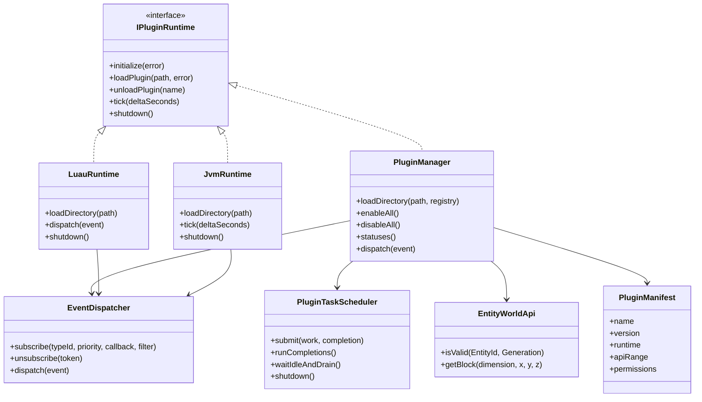
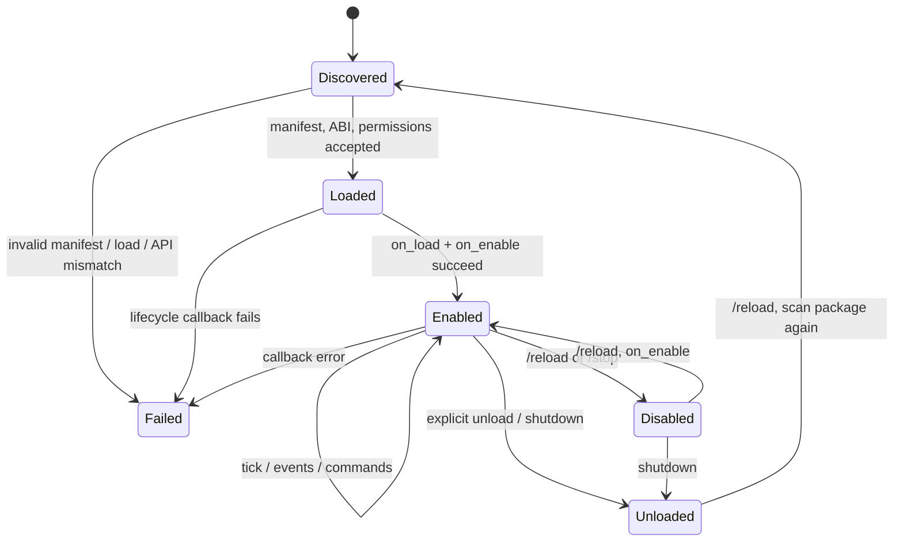

# Плагины Zevvoryn — заметки реализации и тестовые fixtures

## Для владельцев сервера

Linux-установщик на Bash помещает исполняемый файл `zevvoryn` и запускаемый
лаунчер `run_server.sh` в выбранную папку сервера. Запускайте его командой
`./run_server.sh`; мастер первого запуска появится в терминале. В конце
установщик напечатает папку установки и команду запуска. В сборке с поддержкой
плагинов мастер спросит, включать ли их,
а затем позволит выбрать C++, Luau и Java/JVM по отдельности. Рантайм, который
не включён при сборке сервера, нельзя активировать одним флагом конфига.

Linux-лаунчер устанавливает рабочую папку в каталог сервера, поэтому
`settings.properties` создаётся там. При прямом запуске бинарника уже
существующий `settings.properties` рядом с ним имеет приоритет;
если файла ещё нет, мастер первого запуска сохраняет его в текущую рабочую
папку. Чтобы не засорять корень исходного репозитория мирами, логами и конфигом,
запускайте сервер из отдельной папки установки.

Если мастер уже пройден, поменяйте эти параметры в `settings.properties` и
перезапустите сервер:

```properties
enable-plugins=true
enable-cpp-plugins=false
enable-luau-plugins=true
enable-jvm-plugins=false
```

Помещайте плагины в каталог соответствующего runtime внутри папки сервера:
`plugins/cpp/<id>/`, `plugins/luau/<id>/` или `plugins/jvm/<id>/`. Консоль
показывает результат загрузки каждого плагина; `/plugins` выводит статусы,
`/reload` перезагружает плагины, `/stop` корректно останавливает сервер.
Используйте только доверенные плагины и перед включением нативного C++ или Java
кода прочитайте раздел о безопасности ниже.

**Доступность:** эта публикация на GitHub содержит только документацию и не
добавляет runtime плагинов в публичный бинарник сервера. Инструкции применимы
к сборкам, в которые включён соответствующий runtime.

Эта публикация содержит документацию, но не исходный код plugin runtime.
Нативные плагины устанавливаются рядом с сервером пакетами
`plugins/cpp/<каталог>/plugin.json` и entry-модулем (`.dll` на Windows, `.so` на
Linux). Рабочий код — в `src/plugins/`, тесты — в `DevInfo/tools/tests/`;
исходники и fixtures не создают `plugins/` в корне проекта. Сборочные примеры
живут в отдельном build-каталоге; копируйте готовый пакет в папку установленного
сервера или в отдельную тестовую среду, не в `DevInfo/`.
Импортируемый символ — `zevvoryn_plugin_init`, тип `ZevvorynPluginInitV1`.
Windows использует `LoadLibraryW`/`GetProcAddress`, Linux — `dlopen`/`dlsym`;
символ экспортируется через `ZEVVORYN_PLUGIN_EXPORT`. Внешний ABI не переносит
STL или исключения. Нативные модули остаются отображёнными до конца процесса,
так как реестр команд может хранить указатели на их callbacks.
Несовместимый ABI-модуль используется только тестом и собирается отдельно в
`plugin-test-fixtures/`, вне runtime-каталога.

Загрузчик принимает только пакеты с `plugin.json`, проверяет runtime, диапазон
API, относительный entry-путь и наличие файла. При запуске по каждому кандидату
печатается `ENABLED` или `FAILED` с причиной;
`/plugins` выводит список состояний. `/reload` отключает и повторно включает
C++-плагины; `/stop` остаётся корректной остановкой. Падение нативного кода
может завершить весь процесс: crash context указывает активный плагин, но это
не изоляция в отдельном процессе.
Для C ABI доступен `submit_background(work, workUser, completion,
completionUser)`: одна фоновая очередь с лимитом 4096 задач выполняет work на
worker thread и completion на основном tick thread. Worker не должен читать или
изменять мир и не должен синхронно ждать completion. Перед `on_disable` runtime
дожидается worker-задач и доставляет результаты, чтобы plugin-owned task data
можно было безопасно освободить. Этот механизм сам по себе не выдаёт разрешений
на сеть или VFS; нативные C++-модули остаются доверенным кодом.
Главный поток плагинов привязывается к потоку, который действительно
выполняет серверный tick (он может отличаться от потока создания сервера);
completion фоновых задач и изменения мира не выполняются на UI/startup-потоке.
Синхронные команды и cancellable-события, пришедшие не с главного потока,
проходят через отдельную ограниченную очередь (4096 записей): переполнение
отклоняет команду, а событие отменяется по принципу fail-closed. Подписки,
добавленные из callback, начинают участвовать со следующего dispatch.

## Быстрый старт: нативный C++-плагин

1. Создайте пакет `plugins/cpp/<id>/` в папке установленного сервера. Это
   runtime-каталог установленной сборки или отдельная тестовая среда, а не
   корень исходного репозитория или `DevInfo/`. Положите туда `plugin.json` и библиотеку (`.dll`
   Windows / `.so` Linux). Исходники
   своего плагина можно хранить отдельно; используйте заголовок API из сборки
   сервера и соблюдайте описанную ниже ABI-версию.
2. Реализуйте `zevvoryn_plugin_init` и заполните дескриптор ABI. ABI-границу
   составляют только C-типы, function pointers и opaque `void*`; не передавайте
   `std::string`, STL-контейнеры, классы C++ и исключения между DLL/SO и сервером.

Минимальная заготовка:

```cpp
#include "plugin_api.hpp"

namespace {
int32_t onLoad(void*) { return 1; }
void onTick(void*, double) {}
void onDisable(void*) {}
}

extern "C" ZEVVORYN_PLUGIN_EXPORT int32_t zevvoryn_plugin_init(
    const ZevvorynHostApiV1* host, ZevvorynPluginApiV1* plugin) {
    if (!host || !plugin || host->abi_version != ZEVVORYN_PLUGIN_ABI_VERSION ||
        host->struct_size < sizeof(ZevvorynHostApiV1)) return 0;
    plugin->abi_version = ZEVVORYN_PLUGIN_ABI_VERSION;
    plugin->name = "hello-native";       // Должно совпасть с plugin.json
    plugin->version = "1.0.0";            // Должно совпасть с plugin.json
    plugin->on_load = &onLoad;
    plugin->on_tick = &onTick;
    plugin->on_disable = &onDisable;
    return 1;
}
```

Сборка Linux из корня репозитория (выходной файл сразу в отдельной папке
пакета установленного сервера):

```sh
c++ -std=c++20 -fPIC -shared -fvisibility=hidden -Isrc hello.cpp \
  -o /path/to/server/plugins/cpp/hello-native/hello_plugin.so
```

Для Windows используйте MSVC `/LD` и `/I<repo>\src`, выходной файл назовите
`hello_plugin.dll`. Не копируйте сгенерированный runtime-пакет в корень
исходного репозитория.

После `on_load` сервер вызывает `on_enable`; затем `on_tick` на главном потоке,
`on_disable` при `/reload` или остановке и `on_unload` при завершении. Для
команды используйте `host->register_command`, для игрового хука —
`host->subscribe_event` или `host->subscribe_event_filtered`. Право
`commands.register` нужно для команд; `blocks.read` — для подписки на событие и
чтения блока; `blocks.modify` дополнительно нужно для отмены ломания. Пример
Полный пример C++-плагина должен покрывать команды, фильтры событий,
generation-safe handles, доступ к миру и фоновые задачи.

После сборки создайте `plugin.json` по схеме ниже, перезапустите сервер и
проверьте строку `[Plugins] ENABLED hello-native ...`. При отказе загрузки
консоль покажет точный плагин и причину; `/plugins` покажет статусы.

## Архитектура и жизненный цикл





`/reload` intentionally retains native module mappings and command stubs: the
registry currently has no safe command-removal contract, so reinitializing a
module could leave stale callback pointers or duplicate subscriptions. It runs
disable/enable without adding duplicate event subscriptions. `/stop` runs
`on_disable` and `on_unload` while the main tick thread and world still exist.
For JVM and Luau, `/reload` closes the old class loader/VM states, removes event
subscriptions, and loads the package again; native code stays mapped because
the command registry has no safe API for removing plugin command callbacks.

Luau включается `-DZEVVORYN_ENABLE_LUAU=ON` (закреплённый upstream Luau 0.742);
по умолчанию выключен. Скрипты `.luau` загружаются из runtime-каталога
`plugins/luau/`, каждый получает отдельный VM; `os`, `io`, `debug`, `package`,
`require` и загрузчики файлов удалены. Функции `readFile(path)` и
`writeFile(path, contents)` появляются только при одобрении `vfs.read` и
`vfs.write`, работают в `plugins/data/<name>/` и ограничивают размер одного
файла 4 MiB. Скрипт entry возвращает таблицу хуков; callback
`onPlayerBlockBreak` получает поля `playerId`, `x`, `y`, `z`, методы
`isCancelled()` и `cancel()`.
Watchdog проверяет safepoints с бюджетом 250 000 шагов / 20 ms; каждый VM также
ограничен 32 MiB памяти. Это не прерывает нативный код операционной системой.
VFS-нормализатор проверяет относительность, нормализацию и symlink resolution
через `std::filesystem` до открытия файла.

## Манифест и разрешения

```json
{
  "schema_version": 1,
  "name": "example-luau",
  "version": "1.0.0",
  "runtime": "luau",
  "entry": "main.luau",
  "api": { "min": 1, "max": 1 },
  "permissions": {
    "chat.read": false,
    "chat.send": false,
    "blocks.read": false,
    "blocks.modify": false,
    "entities.read": false,
    "commands.register": false,
    "network.access": false,
    "vfs.read": false,
    "vfs.write": false
  }
}
```

`permissions` принимает массив известных строк или объект булевых флагов. Это
запрос плагина, а не автоматическое разрешение. Администратор одобряет права в
`plugins/permissions.json`, например:

```json
{
  "hello": ["commands.register", "blocks.read", "entities.read"],
  "moderation": ["blocks.read", "blocks.modify"]
}
```

Без файла одобрено ноль прав; плагин получает только пересечение запрошенных и
одобренных. Регистрация команд требует `commands.register`; хук ломания блока —
`blocks.read`, отмена события дополнительно требует `blocks.modify`. Права на
`entities.read` открывает проверку дескриптора сущности через пару
`entity_id + generation`; устаревший handle после отключения игрока не проходит
проверку. C ABI также предоставляет `get_block(dimension, x, y, z, out)` при
одобренном `blocks.read` (`0` Overworld, `-1` Nether, `1` End). Оба метода
работают только на серверном tick thread; для недоступного измерения или
неверного потока возвращают отказ. Права на чат и сеть пока не дают возможностей,
так как API для них ещё не открыто.
Нативный ABI также поддерживает `subscribe_event_filtered`: лёгкий C-фильтр
получает компактный event view, а при результате `false` основной callback
плагина не вызывается. Событие ломания блока несёт исходный protocol ID игрока
и отдельный generation-safe `player_entity_id + player_generation` для новых
плагинов; Luau получает те же поля. Регистрация событий всё равно требует
`blocks.read`.
## Создание Java/JVM-плагина

JVM-runtime выключен по умолчанию и включается при сборке через
`-DZEVVORYN_ENABLE_JVM=ON` (нужны JDK и JNI). Для запуска также нужна доступная
JRE/JDK с server VM; при переносе бинарника на другой хост задайте `JAVA_HOME`.
CMake собирает API JAR и пример
в runtime-каталог рядом с сервером: `plugins/jvm/api/` и
`plugins/jvm/example/`. Не кладите сборочные артефакты в корень репозитория.
Для `onPlayerBlockBreak` пример вызывает
`context.subscribePlayerBlockBreak()` в `onLoad`; запрос требует выданное
администратором `blocks.read`. Регистрация доступна на главном потоке сервера;
из собственного Java-потока вызов отклоняется.

Минимальный класс реализует `dev.zevvoryn.api.ZevvorynPlugin`:

```java
package com.example;
import dev.zevvoryn.api.*;

public final class HelloPlugin implements ZevvorynPlugin {
    private PluginContext context;
    public void onLoad(PluginContext context) {
        this.context = context;
        context.log("Hello from Java!");
    }
    public void onPlayerBlockBreak(PlayerBlockBreakEvent event) {
        if (event.x() == 0 && event.canCancel()) event.setCancelled(true);
    }
}
```

Соберите plugin JAR против `plugins/jvm/api/zevvoryn-plugin-api.jar` (например,
`javac -classpath <api-jar> -d <build-classes> HelloPlugin.java`, затем
`jar --create --file plugin.jar -C <build-classes> .`). Файл JAR и манифест
расположите в отдельном runtime-пакете `plugins/jvm/<plugin-id>/`; это каталог
установленного сервера, не исходников проекта. `main_class` — полное имя
класса, `entry` — относительный путь к JAR:

```json
{
  "schema_version": 1,
  "name": "hello-java",
  "version": "1.0.0",
  "runtime": "jvm",
  "entry": "plugin.jar",
  "main_class": "com.example.HelloPlugin",
  "api": { "min": 1, "max": 1 },
  "permissions": ["blocks.read", "blocks.modify", "entities.read"]
}
```

Методы `onLoad`, `onEnable`, `onTick`, `onPlayerBlockBreak`, `onDisable` и
`onUnload` вызываются последовательно на серверном потоке. Доступное API:
`PluginContext.log`, `isEntityValid(id, generation)` и `getBlock(dimension,x,y,z)`;
чтение сущностей/блоков требует соответственно `entities.read` и `blocks.read`.
Событие `PlayerBlockBreakEvent` передаёт компактное представление координат,
protocol player id и generation-safe entity handle; отмена реально применяется
только с `blocks.modify`. Ошибка/исключение фиксируется с именем конкретного
плагина и отключает его callback.

## Граница безопасности Java

**JNI/JVM плагины считаются доверенным исполняемым кодом администратора.**
Разрешения ограничивают только возможности, выданные через Zevvoryn API; это не
ограничивает Java-код, который использует `java.io`, сокеты, reflection,
threads, JNI или собственные библиотеки. Современный Java Security Manager
не является песочницей для этого runtime: API deprecated for removal, а в JDK
24 он permanently disabled; поэтому мы не включаем его и не обещаем изоляцию.
Если автор плагина не полностью доверенный, не запускайте его в том же
процессе: используйте отдельный OS user/container/VM с ограничением файлов,
сети, CPU и памяти.

Log4Shell — не «уязвимость JVM» и не разрешение-плагин: это уязвимость в
затронутых версиях Apache Log4j 2, связанная с обработкой JNDI lookup. Если
плагин добавляет Log4j или другие зависимости, проверяйте весь transitive
dependency tree/SBOM, используйте поддерживаемые исправленные версии и не
логируйте недоверенные данные через небезопасные lookup/configuration. Этот
runtime сам по себе не встраивает Log4j и не может исправить уязвимую
библиотеку, упакованную разработчиком плагина. Поскольку исполняемый плагин
считается доверенным и разделяет адресное пространство, он может обходить
permissions matrix; одобрение администратора обязательно.

Справка: [Security Manager в JDK 24](https://docs.oracle.com/en/java/javase/24/security/security-manager-is-permanently-disabled.html),
[Apache Logging Services: политика и известные уязвимости](https://logging.apache.org/security.html).

Runtime можно отключить в `settings.properties`: `enable-plugins=false`
отключает все плагины, `enable-luau-plugins=false` отключает только Luau, а
`enable-jvm-plugins=false` — только JVM. Для изолированного набора проверок используйте
`-DZEVVORYN_PLUGIN_TESTS_ONLY=ON -DBUILD_TESTING=OFF`; полная старая
`BUILD_TESTING=ON` конфигурация в текущем checkout ссылается на отсутствующие
тестовые исходники вне подсистемы плагинов.
